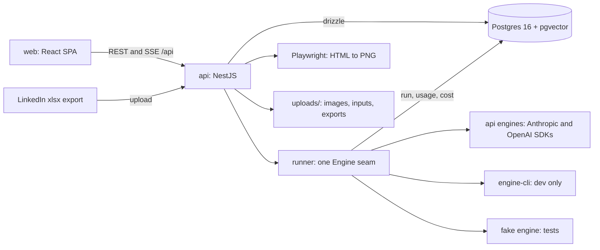

# Forge

Forge drafts, schedules and measures LinkedIn posts, and a person approves each one before it goes out.

**Status: work in progress.** Today it runs on one machine for one person: ideas become posts with drafted text and branded images, the operator approves and publishes by hand, and LinkedIn's analytics exports flow back in. Accounts, automatic publishing, X support and a hosted deployment do not exist yet; they are slices 3 to 13 of the v2 plan, and slice 3 is in design.

## What it is

I wanted to post on LinkedIn every week without handing my voice to a model. Forge keeps the writing mine. A model drafts, refines and proposes images, but nothing leaves the app until I approve it, and every rule about how it writes changes only when I accept a proposal.

The content spine is Idea, Triage, Promote, Post, draft, refine, images, approve, publish, measure, Retro. Every model call along it is recorded as a Run with the prompt the model saw, its output, its token usage and its cost.

The v2 plan turns this into a hosted product for more than one writer, on X first and LinkedIn where LinkedIn's API allows. The architecture spec and 27 ADRs record that plan; the code is two slices into it.

## What works today

- Capture an idea, let a model triage it and suggest a tier, promote it to a post. Evidence: `app/api/test/ideas.spec.ts`, `app/web/src/pages/Backlog.spec.tsx`.
- Draft a post, refine the whole body from feedback, or refine a selected span. Every write is a revision row, which is the only rollback path. Evidence: `test/drafting.spec.ts`, `test/refine-selection.spec.ts`.
- Generate branded image candidates. One lane renders model-written HTML to PNG with Playwright, another composes a generated background under an HTML text layer, and a canvas editor adjusts the result. Evidence: `test/render.spec.ts`, `test/hybrid.spec.ts`, `test/canvas-edit.spec.ts`.
- Schedule posts on a planner against a weekly goal. Evidence: `test/planning.spec.ts`, `test/schedule-endpoint.spec.ts`.
- Import LinkedIn's single-post and aggregate xlsx exports; the app links each export to its post by URL. Evidence: `test/parsers-canonical.spec.ts`, `test/canonical-ingest.spec.ts`.
- Keep a playbook of writing rules, and run a Retro that proposes changes from measured posts. Evidence: `test/playbook.spec.ts`, `test/retro.spec.ts`.
- Route every model call through one engine seam with a model registry, and write usage with cache tokens and cost to a ledger row on every exit path. Evidence: `test/ledger.spec.ts`, `test/run-usage.spec.ts`, `test/registry-http.spec.ts`.
- Delete a post with everything it owns, while its runs and measurements stay. Evidence: `test/post-delete-rm.spec.ts`.

Test paths without a prefix are under `app/api/`.

### Next

From the slice graph in `docs/superpowers/specs/2026-09-24-forge-v2-architecture.md`:

1. Tenancy schema and roles, with row-level security on every table (slice 3).
2. A corpus of past posts and an eval with cross-vendor judges (slice 4).
3. A platform model so one idea can become an X post and a LinkedIn post (slice 5).
4. Signals from edits and a draft score shown on every draft (slice 6).
5. A queue and automatic publishing, X first (slice 8).

## Run it

Not run here: these commands come from the repo's own docs (`CLAUDE.md`, `docs/manual-testing-guide.md`, the `package.json` scripts) and were not executed for this README.

| Fact | Value |
| --- | --- |
| Runtime | Node 22 |
| Package manager | npm, workspaces under `app/` |
| Operating system | Developed on macOS; the database runs in Docker |
| External services | Postgres 16 with pgvector, in Docker |
| Paid keys | Yes for model calls on the `api` backend: `ANTHROPIC_API_KEY` and `OPENAI_API_KEY`. Embeddings also use `OPENAI_API_KEY`; without it retrieval fails closed and drafts show a degraded banner |
| Ports | api 3001, web 5173 by default, Postgres 5433 |
| Time to first run | Not measured |

1. Clone the repo and enter the workspace root.

```sh
git clone https://github.com/kevinshibuya/forge.git
cd forge/app
```

Expect: a directory holding `api`, `web`, `shared`, `engine-cli` and `docker-compose.yml`.

2. Start the database. The init script also creates the `forge_test` database.

```sh
docker compose up -d db
```

Expect: `docker compose ps` shows `forge-db` as healthy on port 5433.

3. Install dependencies.

```sh
npm ci
```

Expect: npm finishes without errors.

4. Create the api's environment file and fill in the keys.

```sh
cp .env.example api/.env
```

Expect: `api/.env` holds `DATABASE_URL`, `TEST_DATABASE_URL` and an empty `OPENAI_API_KEY`. Add `ANTHROPIC_API_KEY` for the `api` backend.

5. Apply the migrations, then seed one example post with rules and an analytics snapshot.

```sh
cd api
npm run db:migrate
npm run db:seed
```

Expect: the seed logs that it stored the documents, the playbook rules and post #1.

6. Start the api on the `api` backend.

```sh
npm run start:api
```

Expect: `curl -s localhost:3001/api/health` returns `{"ok":true}`.

7. In a second terminal, start the web app.

```sh
cd forge/app/web
npm run dev
```

Expect: Vite prints a local URL; the page title reads forge.

### Check it works

From `app/`, with the database running:

```sh
npm run typecheck
npm run lint -w web
npm test
```

Expect: typecheck and lint exit 0, and each workspace's vitest run ends with a `Test Files` line reporting every file passed. The api suite runs against `forge_test`; run only one api vitest process at a time.

### Environment variables

| Name | Required | What it does | How to get a value |
| --- | --- | --- | --- |
| `DATABASE_URL` | Optional | Postgres for the app; defaults to the `forge` database on 5433 | The value in `.env.example` matches the compose file |
| `TEST_DATABASE_URL` | Optional | Postgres for the api tests | The value in `.env.example` |
| `OPENAI_API_KEY` | Required for embeddings and OpenAI runs | Embeddings, and the `openai` engine on the `api` backend | OpenAI dashboard |
| `ANTHROPIC_API_KEY` | Required for Anthropic runs | The `anthropic` engine on the `api` backend | Anthropic console |
| `PORT` | Optional | api port, default 3001 | Any free port |
| `ASSETS_ROOT`, `INPUTS_ROOT` | Optional | Where image files and attached inputs are written, default `api/uploads/` | A writable directory |

`npm run start:dev` boots the `cli` backend instead, which drives the `claude` and `codex` command-line tools already logged in on the machine. It exists for development and never ships in the production build.

### If it fails

- Every api spec fails with connection refused: Docker has stopped. Check `docker info` and start the database again.
- The api runs old shared code after a change in `app/shared`: the api loads `@forge/shared` from `dist/`. Run `npm run build -w @forge/shared` and restart the api.
- The web smoke reports the wrong page: another app holds the port. Check that the page `<title>` says forge.

Agents: the working rules and known traps live in `CLAUDE.md`; the domain language lives in `CONTEXT.md`.

## How it's built



| Path | What lives there |
| --- | --- |
| `app/api/src` | NestJS modules: posts, ideas, drafting, images, analytics, runner, registry, ledger |
| `app/api/src/db/migrations` | Hand-written SQL migrations and their journal |
| `app/api/test` | api specs against `forge_test`, and fixtures such as the synthetic LinkedIn exports |
| `app/api/scripts` | The route smoke, contract probes and the fixture generator |
| `app/engine-cli` | The development-only `cli` backend |
| `app/shared` | Zod schemas and types shared by api and web, including the output contract |
| `app/web/src` | React pages and UI components |
| `docs/adr` | 27 architecture decision records |
| `docs/superpowers/specs`, `docs/plans` | Design specs and implementation plans |
| `research`, `post-assets` | Seed inputs: the design language and post #1's image |

## Why it's built this way

**The engine enforces the output contract, and a model can decline inside it.** Runs used to end with one prompt line, "respond with JSON only". Run 111 answered a placeholder idea with prose explaining why it would not write the post, and run 113 returned JSON with the wrong keys; both were recorded as `invalid_output` although the model behaved well. Now every structured run gets a JSON Schema whose result is either the payload or a decline with a reason, and a decline is a failed run with failure kind `declined`. A repair pass, a retry and a text fallback were all rejected, because each hides the broken contract instead of fixing it. [ADR 0016](docs/adr/0016-output-contract-is-engine-enforced.md)

**Analytics come from hand-exported spreadsheets, not the LinkedIn API.** The API needs a registered legal organization, a business email and an app verified by a Page admin, and its Development tier caps an app at 500 calls a day. Automating the export button breaks LinkedIn's User Agreement §8.2, which names browser plugins, and the account at risk is the one holding the history. The "get a copy of your data" archive holds no impressions at all. The cost is about a minute of clicking per week. [ADR 0002](docs/adr/0002-manual-export-ingestion-not-the-linkedin-api.md)

**Analytics facts are split by grain, and there is no per-post daily table.** "Impressões" is lifetime on a single-post export, daily on the Engajamento sheet and window-scoped on Descoberta, so one flat snapshot table mixed three meanings. Four fact tables now hold daily, lifetime, window and audience facts, and window facts always carry their bounds. A per-post daily table was left out because no export contains that grain. The cost is that every labelled row in an export must map to a metric or sit on an explicit skip list. [ADR 0007](docs/adr/0007-canonical-two-grain-analytics-model.md)

**An export links to its post by exact URL first, typed URN second.** The planned `activity` regex matched zero real URLs, because every export and stored URL uses the `-share-` or `-ugcPost-` slug form. The same post also carries different numeric ids under different URN types, while its slug URL stays the same. The dedupe order is now fixed: URL, then URN, then insert. An export with no matching post lands unlinked and heals when the file is uploaded again. [ADR 0008](docs/adr/0008-post-identity-is-a-typed-urn-with-url-first-linking.md)

**Three engine backends, and the CLI one never ships.** The deployment picks `fake` for tests, `api` for the hosted product and `cli` for development; a user never picks. The `cli` backend lives in its own workspace, and `test/no-cli-in-prod.spec.ts` walks the production entry's file trace and fails on any reference to it, so "no CLI code in production" is a build fact. The Vercel AI SDK was not adopted because its cache-token reporting was unverified. The cost is a build order: `@forge/engine-cli` and `@forge/shared` compile before the api. [ADR 0019](docs/adr/0019-three-engine-backends-and-the-cli-package-boundary.md)

**A post is deleted whole, but its runs and measurements stay.** Revisions, inputs, assets and embeddings go with the post in one transaction, and the idea returns to the backlog. Runs survive because every model call stays audited, and export facts survive because they are LinkedIn's record. A measured post refuses deletion, since its facts are the one thing that cannot be regenerated. Soft delete was rejected because every reader would filter deleted rows forever. [ADR 0018](docs/adr/0018-a-post-is-deleted-whole.md)

**Component tests cover only what the route smoke cannot reach.** `route-smoke.mjs` drives real Chromium against the real api and is the only proof that pages render. The vitest suite in `app/web` owns injected states a healthy server never shows, such as a failing query. Page tests with a mocked network were rejected because their green is weaker evidence than the smoke's, and legibility is checked by reading the rendered page. [ADR 0013](docs/adr/0013-component-tests-supplement-route-smoke-zero-overlap.md)

**Publishing will be a state machine that posts at most once on its own.** This one is designed for slice 8, not built. A failure before the request was sent retries as a new attempt; any error after it was sent counts as a crash, because the platform may have created the post. The first draft of the ADR retried 5xx responses, and that is a blind retry that double-posts on LinkedIn. On LinkedIn a crash goes to `needs_review` for the user, since the scope that lists a member's posts is unavailable. [ADR 0024](docs/adr/0024-publish-is-a-state-machine-not-a-run.md)

## How it was made

Each piece of work starts as a spec, becomes a set of tickets, and is built in gated agent runs in Claude Code, with typecheck, lint, focused tests and the route smoke as the gate. The owner reviews every pull request and approves each design before code is written. The working rules are in [`CLAUDE.md`](CLAUDE.md) and the decisions in [`docs/adr`](docs/adr).

## Credits and licence

Dependencies are installed from npm under their own licences; the main ones are NestJS, React, Vite, drizzle-orm, ExcelJS, Playwright, zod and the Anthropic and OpenAI SDKs. Generated post images load Plus Jakarta Sans from Google Fonts at render time, under the SIL Open Font License. The analytics fixtures in `app/api/test/fixtures/synthetic-exports` are invented data built by `app/api/scripts/make-synthetic-exports.mjs`.

LinkedIn is a trademark of LinkedIn Corporation. Forge is not affiliated with or endorsed by LinkedIn.

MIT licence, `Copyright (c) 2026 Kevin Shibuya`. See [LICENSE](LICENSE).
